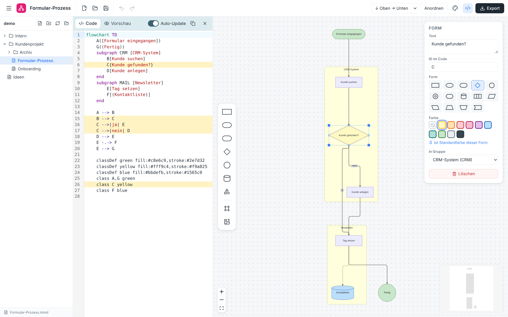
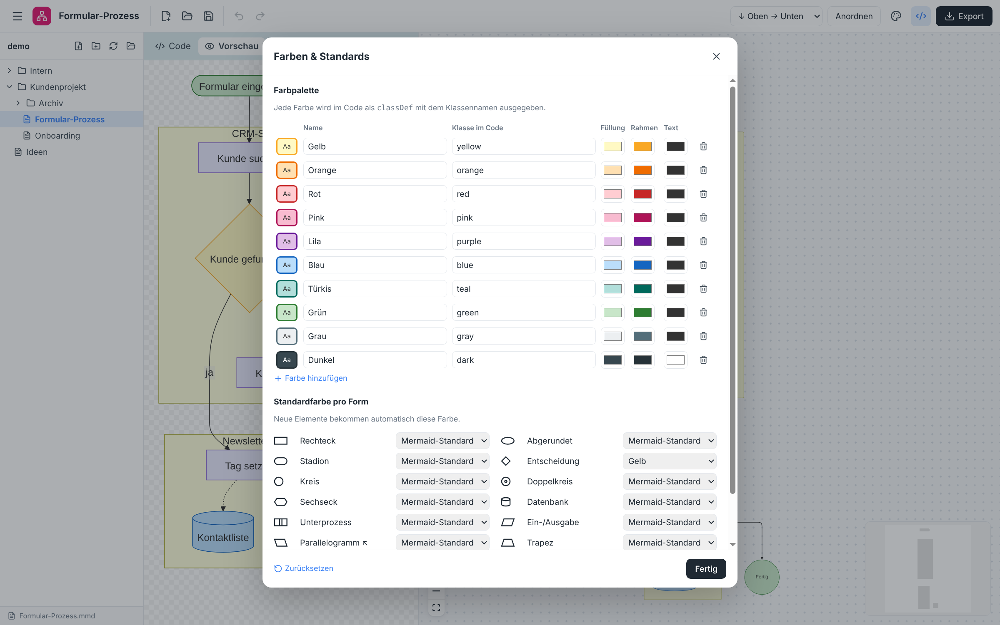
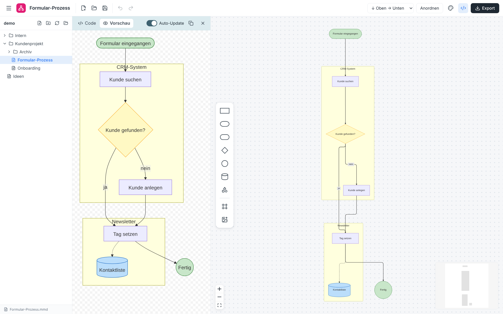

# Mermaid Editor

**Diagramme zeichnen wie auf einem Whiteboard – und sauberen Mermaid-Code zurückbekommen.**

Hab ich gebraucht für ein Kundenprojekt. Claude for the Win!



Du ziehst Formen auf die Fläche, verbindest sie mit Pfeilen und färbst sie ein – der Editor schreibt dabei automatisch gut lesbaren [Mermaid](https://mermaid.js.org)-Code mit. Das funktioniert auch umgekehrt: Änderst du den Code, passt sich die Zeichnung sofort an.

---

## Inhalt

- [Installation](#installation)
- [Erste Schritte](#erste-schritte)
- [Formen zeichnen](#formen-zeichnen)
- [Verbindungen](#verbindungen)
- [Gruppen (Subgraphs)](#gruppen-subgraphs)
- [Farben](#farben)
- [Bilder einfügen](#bilder-einfügen)
- [Mit Code arbeiten](#mit-code-arbeiten)
- [Dateien und Ordner](#dateien-und-ordner)
- [Exportieren](#exportieren)
- [Tastenkürzel](#tastenkürzel)
- [Häufige Fragen](#häufige-fragen)
- [Für Entwickler](#für-entwickler)

---

## Installation

### Windows
1. Lade die aktuelle Version herunter: auf GitHub unter **Actions → „Desktop-App bauen“ → letzter Lauf → Artifacts** die Datei `mermaid-editor-windows-latest`.
2. Entpacke die ZIP-Datei. Du findest darin zwei Varianten:
   - **`Mermaid Editor Setup ….exe`** – installiert die App mit Startmenü-Eintrag. Danach öffnen sich `.mmd`-Dateien per Doppelklick direkt im Editor.
   - **`Mermaid Editor ….exe`** (portable) – läuft ohne Installation, z. B. von einem USB-Stick.
3. Beim ersten Start meldet Windows eventuell „Der Computer wurde durch Windows geschützt“. Klicke auf **Weitere Informationen → Trotzdem ausführen**. Das liegt nur daran, dass die App nicht kostenpflichtig signiert ist.

### macOS und Linux
Genauso, nur mit dem Artefakt `mermaid-editor-macos-latest` (`.dmg`) bzw. `mermaid-editor-ubuntu-latest` (`.AppImage`).

> **Noch kein Download vorhanden?** In GitHub unter **Actions → „Desktop-App bauen“ → „Run workflow“** klicken. Nach einigen Minuten stehen die Dateien bereit.

---

## Erste Schritte

1. **Arbeitsordner wählen:** Klicke links in der Seitenleiste auf **„Ordner wählen“** und such dir den Ordner aus, in dem deine Diagramme liegen sollen. Die App merkt sich den Ordner.
2. **Neues Diagramm anlegen:** Klicke oben in der Seitenleiste auf das Symbol mit dem Plus-Blatt, gib einen Namen ein und drücke `Enter`.
3. **Zeichnen:** Doppelklicke irgendwo auf die Fläche – eine neue Form erscheint und du kannst direkt den Text eintippen.
4. **Weiter geht's mit `Tab`:** Ist eine Form ausgewählt, erzeugt `Tab` die nächste Form – schon verbunden. So entsteht ein Ablauf in Sekunden.
5. **Speichern:** `Strg + S`. Ein Punkt hinter dem Dateinamen zeigt an, dass es ungespeicherte Änderungen gibt.

---

## Formen zeichnen

Die **Werkzeugleiste links auf der Fläche** enthält die wichtigsten Formen. Du kannst eine Form

- **anklicken** – sie erscheint in der Mitte der Ansicht, oder
- **auf die Fläche ziehen** – sie landet genau dort, wo du sie loslässt.

Über das Symbol mit den drei kleinen Formen erreichst du **alle 14 Formen**:

| Form | Typische Bedeutung |
| --- | --- |
| Rechteck | Arbeitsschritt |
| Abgerundet / Stadion | Start, Ende, Ereignis |
| Raute | Entscheidung (ja/nein) |
| Kreis / Doppelkreis | Start-/Endpunkt |
| Datenbank | Datenspeicher, System |
| Unterprozess | Verweis auf einen anderen Ablauf |
| Sechseck | Vorbereitung |
| Parallelogramm | Ein- oder Ausgabe |
| Trapez, Fahne | Sonstiges |

**Bearbeiten:**
- **Text ändern:** Doppelklick auf die Form (oder auswählen und `Enter`). `Shift + Enter` erzeugt eine neue Zeile.
- **Verschieben:** einfach ziehen. Mehrere Formen wählst du mit `Shift` + Ziehen eines Rahmens oder `Strg` + Klick aus.
- **Größe ändern:** an den blauen Eckpunkten der ausgewählten Form ziehen.
- **Form tauschen:** Rechts im Eigenschaften-Panel eine andere Form anklicken – Text und Verbindungen bleiben erhalten.

**Ansicht:** Mit dem **Mausrad zoomst** du, durch **Ziehen auf freier Fläche** verschiebst du die Ansicht. `Shift + 1` zeigt das ganze Diagramm.
**Anordnen** (oben rechts oder `Strg + L`) ordnet alles automatisch ordentlich an. Die Richtung (oben → unten, links → rechts …) wählst du daneben.

---

## Verbindungen

- **Verbinden:** Fahre mit der Maus über eine Form – an den Rändern erscheinen kleine Punkte. Ziehe von einem Punkt zur Zielform.
- **Neue Form direkt anhängen:** Ziehe die Verbindung einfach **ins Leere** – dort entsteht sofort eine neue, verbundene Form.
- **Beschriften:** Doppelklick auf die Linie, z. B. „ja“ oder „nein“.
- **Aussehen ändern:** Linie anklicken und im Eigenschaften-Panel wählen:
  - Linie: durchgezogen, gepunktet oder dick
  - Spitze: Pfeil, keine, Kreis oder Kreuz – auf Wunsch an beiden Enden
  - „Richtung umkehren“ dreht den Pfeil um

Der zuletzt gewählte Linienstil wird für neue Verbindungen übernommen.

---

## Gruppen (Subgraphs)

Gruppen fassen zusammengehörige Schritte zusammen, z. B. alles, was in einem bestimmten System passiert.

1. Klicke in der Werkzeugleiste auf das **Rahmen-Symbol** (oder ziehe es auf die Fläche).
2. **Ziehe Formen in die Gruppe hinein** – sie gehören dann dazu und wandern mit, wenn du die Gruppe verschiebst. Herausziehen löst sie wieder.
3. Doppelklick auf den Titel benennt die Gruppe um.
4. Im Eigenschaften-Panel kannst du der Gruppe eine **eigene Richtung** geben und sie einfärben.

Gruppen lassen sich auch verschachteln. Löschst du eine Gruppe, bleiben ihre Inhalte erhalten.

---

## Farben

Wähle eine oder mehrere Formen aus und klicke rechts im Panel auf eine Farbe. Im Code erscheint das als `classDef` – genau so, wie Mermaid es erwartet.



Über das **Paletten-Symbol 🎨** oben rechts kannst du

- **eigene Farben anlegen** (Name, Füllung, Rahmen, Textfarbe) und vorhandene anpassen,
- für jede Form eine **Standardfarbe** festlegen – z. B. Entscheidungen immer gelb, Datenbanken immer blau. Neue Formen bekommen diese Farbe dann automatisch.

Schneller Weg: Form einfärben und im Panel auf **„Als Standardfarbe für diese Form“** klicken.

Die Einstellungen gelten für alle Fenster und bleiben beim nächsten Start erhalten.

---

## Bilder einfügen

- Klicke in der Werkzeugleiste auf das **Bild-Symbol** und wähle eine Datei, **oder**
- ziehe ein Bild direkt **aus dem Explorer/Finder auf die Fläche**.

Liegt das Bild im selben Ordner wie das Diagramm (oder darunter), wird ein relativer Pfad gespeichert. So kannst du den ganzen Ordner weitergeben, ohne dass Bilder fehlen.

---

## Mit Code arbeiten

Links neben der Fläche siehst du den Mermaid-Code (ein-/ausblenden mit `Strg + J`).

- **Auto-Update an:** Jede Änderung im Code erscheint nach einem kurzen Moment auf der Fläche. Du kannst also auch fertigen Mermaid-Code hineinkopieren – das Diagramm wird automatisch angeordnet.
- **Auto-Update aus:** Du tippst in Ruhe und übernimmst mit dem Button bzw. `Strg + Enter`.
- **Fehler** werden unter dem Code mit Zeilennummer angezeigt; die Zeichnung bleibt so lange unverändert.
- Ausgewählte Formen werden im Code **gelb hervorgehoben** – praktisch, um sich zurechtzufinden.
- Der Reiter **Vorschau** zeigt, wie Mermaid selbst das Diagramm darstellt (genau so sieht es später z. B. in GitHub, Notion oder Confluence aus).



**Kopieren:** Das Kopier-Symbol im Code-Panel (oder `Strg + Shift + C`) legt den fertigen Code in die Zwischenablage – bereit zum Einfügen in Markdown, Wikis oder Tickets.

---

## Dateien und Ordner

- **Seitenleiste** (`Strg + B`): zeigt alle `.mmd`-Dateien im Arbeitsordner samt Unterordnern. Neue Dateien und Ordner legst du über die Symbole oben an. Den Arbeitsordner wechselst du mit dem Ordner-Symbol.
- **Dateien von woanders öffnen:** über **Öffnen** (`Strg + O`), per Drag & Drop einer `.mmd`-Datei auf die Fläche oder – nach der Installation – per Doppelklick im Explorer.
- **Mehrere Diagramme gleichzeitig:** Jedes Diagramm öffnet sich in einem **eigenen Fenster**. Ist eine Datei schon offen, wird einfach ihr Fenster nach vorne geholt. Ein neues, leeres Fenster bekommst du mit `Strg + N`.
- **Nichts geht verloren:** Schließt du ein Fenster mit ungespeicherten Änderungen, fragt die App nach.

**Was steht in der Datei?** Ganz normaler Mermaid-Code. Damit deine Anordnung erhalten bleibt, hängt die App am Ende eine einzelne Kommentarzeile an:

```
%% @layout {"A":[40,40],"B":[45,170]}
```

Mermaid ignoriert diese Zeile, du kannst die Datei also überall verwenden. Beim Kopieren und Exportieren wird sie weggelassen.

---

## Exportieren

Über den Button **Export** oben rechts:

| Format | Wofür |
| --- | --- |
| **PNG (transparent)** | Präsentationen, E-Mails, Dokumente (`Strg + E`) |
| **SVG (transparent)** | gestochen scharf in jeder Größe, z. B. für Druck oder Web |
| **Mermaid-Code kopieren** | Markdown, GitHub, Notion, Confluence … |
| **Als .mmd speichern** | Diagramm-Datei an anderer Stelle ablegen |

Exportiert wird **ohne Hintergrund und ohne Gitter** – nur dein Diagramm.

---

## Tastenkürzel

| Kürzel | Aktion |
| --- | --- |
| Doppelklick auf Fläche | neue Form |
| Doppelklick auf Form / Linie | Text bearbeiten |
| `Enter` / `F2` | Text der Auswahl bearbeiten |
| `Tab` | neue verbundene Folge-Form |
| `Shift + Tab` | neue Form daneben |
| `Entf` / `Rücktaste` | Auswahl löschen |
| `Pfeiltasten` | Auswahl verschieben (`Shift`: in größeren Schritten) |
| `Strg + D` | duplizieren |
| `Strg + A` | alles auswählen |
| `Strg + Z` / `Strg + Y` | rückgängig / wiederholen |
| `Strg + L` | automatisch anordnen |
| `Shift + 1` | ganzes Diagramm anzeigen |
| `Strg + S` / `Strg + Shift + S` | speichern / speichern unter |
| `Strg + O` / `Strg + N` | öffnen / neues Fenster |
| `Strg + B` / `Strg + J` | Seitenleiste / Code ein- und ausblenden |
| `Strg + E` | als PNG exportieren |
| `Strg + Enter` (im Code) | Code übernehmen |

Auf dem Mac jeweils `Cmd` statt `Strg`. Die Liste gibt es auch in der App unter **Hilfe → Tastenkürzel**.

---

## Häufige Fragen

**Welche Diagrammarten werden unterstützt?**
Flowcharts (`flowchart` bzw. `graph`) – also klassische Ablauf- und Prozessdiagramme. Andere Mermaid-Typen (Sequenz-, Gantt-Diagramme …) zeigt der Code-Editor als Fehler an.

**Ich habe fertigen Mermaid-Code. Kann ich den weiterbearbeiten?**
Ja. Öffne die Datei oder füge den Code einfach ins Code-Panel ein. Ohne gespeicherte Anordnung wird das Diagramm automatisch angeordnet.

**Warum sieht die Vorschau etwas anders aus als die Zeichenfläche?**
Die Fläche ist zum Bearbeiten da, die Vorschau ist die echte Mermaid-Darstellung. Mermaid ordnet die Formen beim Anzeigen selbst an – deine Positionen auf der Fläche nutzt es nicht. Inhalt, Formen, Farben und Verbindungen sind aber identisch.

**Ich habe eine Palettenfarbe geändert, aber mein Diagramm sieht noch gleich aus.**
Bestehende Diagramme behalten ihre Farben. Weise die Farbe der Form einfach noch einmal zu, dann wird sie aktualisiert.

**Etwas ist schiefgegangen.**
`Strg + Z` macht fast alles rückgängig – auch Änderungen über den Code.

---

## Für Entwickler

Voraussetzung: [Node.js](https://nodejs.org) 20 oder neuer.

```bash
npm install
npm run dev          # Desktop-App mit Hot Reload
npm run dev:web      # nur die Oberfläche im Browser (ohne Ordnerzugriff)
npm test             # Tests für Parser und Generator
npm run dist:win     # Windows-Installer + portable .exe in release/
npm run dist:mac     # macOS .dmg
npm run dist:linux   # Linux AppImage
```

Der GitHub-Workflow **„Desktop-App bauen“** (manuell startbar oder per Tag `v*`) erstellt die Installer für alle drei Systeme.

| Pfad | Inhalt |
| --- | --- |
| `electron/main.cjs` | Fenster (eins pro Diagramm), Dateizugriff, Arbeitsordner, Menü |
| `electron/preload.cjs` | sichere Brücke zwischen Oberfläche und Hauptprozess |
| `src/model.ts` | Datenmodell, Formen, Farbpalette |
| `src/mermaid/parse.ts` | Mermaid-Code → Diagramm |
| `src/mermaid/generate.ts` | Diagramm → sauberer Mermaid-Code |
| `src/layout.ts` | automatisches Anordnen (dagre) |
| `src/store.ts` | Zustand, Rückgängig/Wiederholen, Abgleich Code ↔ Fläche |
| `src/components/` | Zeichenfläche, Werkzeugleiste, Eigenschaften, Code-Panel, Seitenleiste |

Gebaut mit Electron, React, [React Flow](https://reactflow.dev), [Mermaid](https://mermaid.js.org) und CodeMirror.
